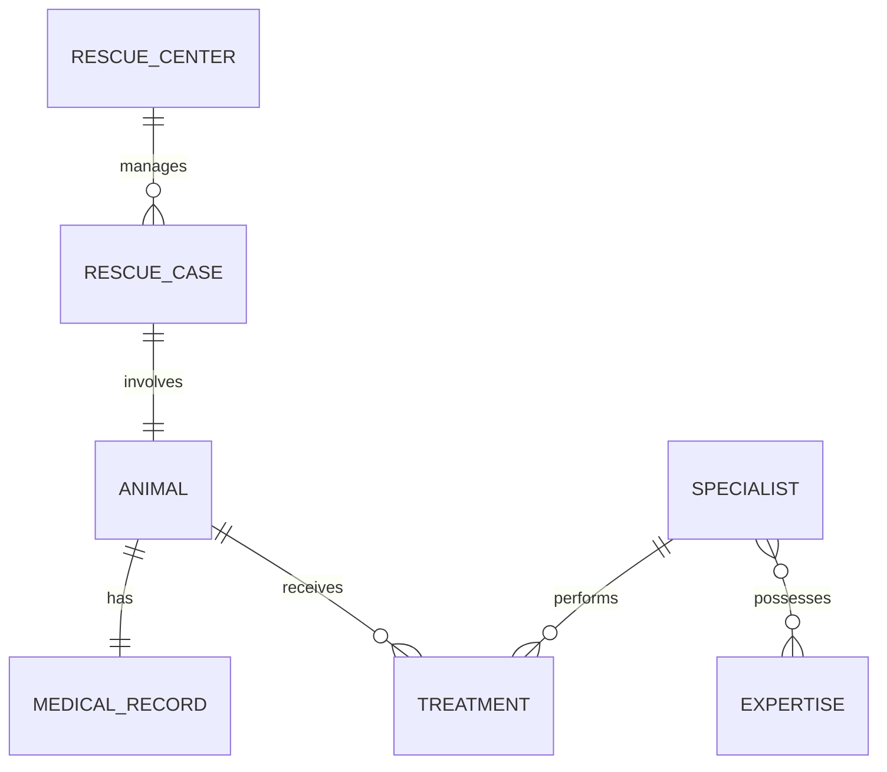

## Taller 2: DeepBlue Rescue

**RUIZ ROLANDO G2, TORRES LUZ G3**

## 1. Descripción 

DeepBlue Rescue es la capa de persistencia de una plataforma para organizaciones dedicadas al rescate y rehabilitación de fauna marina.

Este proyecto modela el flujo completo de un proceso de rescate: un centro registra un caso, se identifica al animal involucrado, se abre su expediente médico, distintos especialistas participan en su recuperación aplicando tratamientos, y el caso evoluciona a través de distintos estados hasta su liberación o cierre.

Este laboratorio está dedicado exclusivamente a persistencia: modelo relacional, migraciones Flyway, entidades JPA, repositories y pruebas de integración contra PostgreSQL real mediante Testcontainers. No incluye Controller, REST API, Service, DTO, Spring Security, Frontend, Kafka ni Docker Compose.


## 2. Modelo de datos

### Entidades / tablas

| Entidad JPA     | Tabla                  | Tipo                   |
|-----------------|------------------------|------------------------|
| RescueCenter    | rescue_centers         | Entidad                |
| RescueCase      | rescue_cases           | Entidad                |
| Animal          | animals                | Entidad                |
| MedicalRecord   | medical_records        | Entidad                |
| Specialist      | specialists            | Entidad                |
| Expertise       | expertise              | Entidad                |
| —               | specialist_expertise   | Tabla asociativa (N:M) |
| Treatment       | treatments             | Entidad                |

### Enums

- RescueStatus: ADMITTED, UNDER_EVALUATION, IN_REHABILITATION, READY_FOR_RELEASE, RELEASED, CLOSED
- AnimalSex: MALE, FEMALE, UNKNOWN
- TreatmentType: WOUND_CARE, HYDRATION, MEDICATION, SURGERY, NUTRITION, PHYSIOTHERAPY, OBSERVATION

### Constraints principales

- rescue_centers.code -> UNIQUE
- rescue_cases.case_code -> UNIQUE; rescue_cases.status -> CHECK (solo estados válidos de RescueStatus)
- animals.animal_code -> UNIQUE; animals.rescue_case_id -> FK UNIQUE` (garantiza 1:1)
- medical_records.animal_id -> FK UNIQUE` (garantiza 1:1)
- specialists.professional_code y specialists.email -> UNIQUE`
- expertise.name -> UNIQUE
- specialist_expertise -> PK compuesta (specialist_id, expertise_id)
- treatments -> animal_id, specialist_id, performed_at, type -> NOT NULL; ambas FK
- animals.tracking_device_code (agregado en V3) -> NULL permitido, pero UNIQUE cuando existe

### Índices

rescue_cases.rescue_center_id, rescue_cases.status, rescue_cases.rescue_date, treatments.animal_id, treatments.specialist_id, treatments.performed_at.

### Diagrama entidad-relación




## 3. Relaciones

Relación	               | Cardinalidad | Explicación                   | Ubicación de FK
RescueCenter -> RescueCase | 1 : N	 | Un centro tiene muchos casos       | RescueCase.rescue_center_id
RescueCase -> Animal	   | 1 : 1   | Un caso tiene un animal asociado   | Animal.rescue_case_id
Animal -> MedicalRecord	   | 1 : 1   | Un animal tiene un registro médico | MedicalRecord.animal_id
Animal -> Treatment	       | 1 : N   | Un animal puede recibir muchos tratamientos |Treatment.animal_id 
Specialist -> Treatment	   | 1 : N   | Un especialista puede realizar muchos tratamientos |Treatment.specialist_id
Specialist <-> Expertise   | N : M   | Un especialista puede tener varias especialidades y viceversa |specialist_expertise


## 4. Instrucciones para ejecutar

### Requisitos previos

- Java 21
- Maven
- Docker en ejecución (necesario para Testcontainers)
- PostgreSQL disponible si se desea ejecutar la aplicación fuera de los tests (no es obligatorio para correr las pruebas)

### Configuración

El archivo src/main/resources/application.yml usa variables de entorno con valores por defecto:

```yaml
DB_URL=jdbc:postgresql://localhost:5432/deepblue
DB_USER=postgres
DB_PASSWORD=postgres
```

ddl-auto está fijado en validate: Hibernate nunca crea ni modifica el esquema; solo Flyway lo hace, ejecutando las migraciones ubicadas en db/migration. Esto obliga a que el modelo de negocio, el modelo relacional y las entidades JPA se mantengan siempre coherentes entre sí.

### Compilar el proyecto

```bash
mvn clean compile
```

### Levantar la aplicación (opcional, requiere PostgreSQL real)

```bash
mvn spring-boot:run
```


## 5. Instrucciones para ejecutar los tests

```bash
mvn clean test
```

Resultado esperado:

```
BUILD SUCCESS
```

Durante la ejecución, en otra terminal se puede comprobar que Testcontainers levanta un contenedor temporal:

```bash
docker ps
```

Se observará un contenedor postgres:18-alpine activo mientras corren las pruebas. En los logs puede verificarse la secuencia:

1. Flyway ejecuta V1, V2 y V3 sobre el contenedor.
2. Hibernate valida el esquema resultante contra las entidades (ddl-auto: validate), sin crear ni alterar nada.


## 6. Explicación de Flyway

Flyway es la herramienta responsable de crear y evolucionar el esquema de base de datos mediante migraciones versionadas y ordenadas:

- V1__create_schema.sql: crea todas las tablas (rescue_centers, rescue_cases, animals, medical_records, specialists, expertise, specialist_expertise, treatments), sus PK, FK, UNIQUE, CHECK (estados válidos de rescue_cases.status) e índices.

- V2__insert_expertise_catalog.sql: inserta el catálogo inicial de especialidades (Marine Reptiles, Marine Mammals, Marine Birds, Trauma, Rehabilitation, Toxicology).

- V3__add_tracking_device_to_animal.sql: agrega la columna tracking_device_code (nullable, UNIQUE cuando tiene valor) a animals, sin modificar V1 — así es como se evoluciona un esquema ya migrado.

Cada migración se ejecuta una única vez y su historial queda registrado en la tabla flyway_schema_history, lo que permite comprobar que el esquema fue creado por Flyway y no por Hibernate. Por eso se usa ddl-auto: validate en lugar de create o update: Hibernate solo verifica que las entidades coincidan con el esquema real, pero nunca lo modifica. Esto evita que el modelo de la aplicación y el de la base de datos diverjan silenciosamente, y refleja cómo se gestionan los esquemas en un entorno real (producción no permite que un ORM altere la base de datos automáticamente).


## 7. Explicación de Testcontainers

Testcontainers permite ejecutar las pruebas de integración contra una instancia real de PostgreSQL, levantada automáticamente en un contenedor Docker durante la ejecución de los tests.

Elementos clave usados en PersistenceIntegrationTest:

```java
@Testcontainers
@SpringBootTest
@Transactional
class PersistenceIntegrationTest {

    @Container
    @ServiceConnection
    static final PostgreSQLContainer postgres =
            new PostgreSQLContainer("postgres:18-alpine")
                .withDatabaseName("deepblue_test")
                .withUsername("deepblue")
                .withPassword("deepblue");
}
```

- @Container: gestiona el ciclo de vida del contenedor (arranque y apagado automáticos).
- @ServiceConnection: conecta automáticamente el DataSource de Spring Boot al contenedor, sin configurar    manualmente URL, usuario ni contraseña.
- @Transactional: revierte los cambios de cada test, manteniendo el aislamiento entre pruebas.


---

## 8. Query Methods implementados

El proyecto utiliza Query Methods de Spring Data JPA para realizar consultas simples sobre las entidades y para navegar las relaciones entre ellas, evitando utilizar @Query cuando la consulta puede expresarse directamente mediante el nombre del método.

- RescueCenterRepository:
    findByCode(String code): busca un centro de rescate mediante su código y retorna un Optional<RescueCenter>

- RescueCaseRepository
    findByCaseCode(String caseCode): busca un caso de rescate mediante su código

    findByStatusOrderByRescueDateAsc(RescueStatus status): busca casos según su estado y los ordena por fecha de rescate de forma ascendente

    findByRescueCenterCode(String code): busca los casos pertenecientes a un centro mediante el código del centro

    findByRescueDateAfterOrderByRescueDateDesc(LocalDate date): obtiene los casos posteriores a una fecha determinada y los ordena desde el más reciente hasta el más antiguo

- AnimalRepository
    findByAnimalCode(String animalCode): busca un animal mediante su código

    findByCommonNameContainingIgnoreCase(String commonName): busca animales cuyo nombre común contenga determinado texto, ignorando mayúsculas y minúsculas

    findByRescueCaseStatus(RescueStatus status): obtiene animales cuyo caso de rescate tiene un estado determinado

    findByRescueCaseRescueCenterCode(String centerCode): obtiene animales pertenecientes a un centro determinado navegando las relaciones Animal -> RescueCase -> RescueCenter -> code

- ExpertiseRepository
    findByNameIgnoreCase(String name): busca un área de experiencia ignorando diferencias entre mayúsculas y minúsculas

- TreatmentRepository
    findByAnimalIdOrderByPerformedAtAsc(Long animalId): obtiene los tratamientos de un animal y los ordena cronológicamente de forma ascendente


## 9. Consultas JPQL implementadas (@Query)

- SpecialistRepository
    findActiveByExpertise(String expertiseName): obtiene especialistas activos que poseen una determinada área de experiencia. Utiliza JOIN, LOWER, DISTINCT, parámetro nombrado y ORDER BY

- TreatmentRepository
    findBetweenDates(LocalDateTime start, LocalDateTime end): obtiene los tratamientos realizados entre dos fechas y los ordena cronológicamente de forma ascendente

    findByCenterCode(String centerCode): obtiene los tratamientos realizados a animales pertenecientes a un centro determinado, navegando las relaciones Treatment -> Animal -> RescueCase -> RescueCenter

    findBySpecialistExpertise(String expertiseName): obtiene los tratamientos realizados por especialistas que poseen una determinada área de experiencia, navegando la relación Treatment -> Specialist -> Expertise. Utiliza JOIN, DISTINCT y un parámetro nombrado.


## Clasificación de consultas

| Necesidad                                   | Mecanismo       |
|---------------------------------------------|-----------------|
| Buscar una entidad por ID                   | Método heredado |
| Buscar caso por código                      | Query Method    |
| Casos según status                          | Query Method    |
| Animales de determinado centro              | Query Method    |
| Especialistas según expertise               | @Query + JPQL   |
| Tratamientos en intervalo                   | @Query + JPQL   |
| Tratamientos por expertise del especialista | @Query + JPQL   |


## Estructura del proyecto

deepblue-rescue/
├── pom.xml
├── src/main/java/com/deepblue/rescue
│   ├── DeepBlueRescueApplication.java
│   ├── domain
│   │   ├── RescueCenter.java
│   │   ├── RescueCase.java
│   │   ├── RescueStatus.java
│   │   ├── Animal.java
│   │   ├── AnimalSex.java
│   │   ├── MedicalRecord.java
│   │   ├── Specialist.java
│   │   ├── Expertise.java
│   │   ├── Treatment.java
│   │   └── TreatmentType.java
│   └── repository
│       ├── RescueCenterRepository.java
│       ├── RescueCaseRepository.java
│       ├── AnimalRepository.java
│       ├── MedicalRecordRepository.java
│       ├── SpecialistRepository.java
│       ├── ExpertiseRepository.java
│       └── TreatmentRepository.java
├── src/main/resources
│   ├── application.yml
│   └── db/migration
│       ├── V1__create_schema.sql
│       ├── V2__insert_expertise_catalog.sql
│       └── V3__add_tracking_device_to_animal.sql
├── src/test/java/com/deepblue/rescue
│   └── PersistenceIntegrationTest.java
└── README.md
